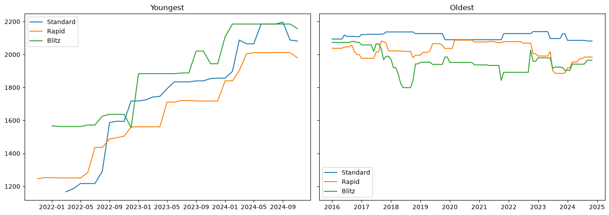
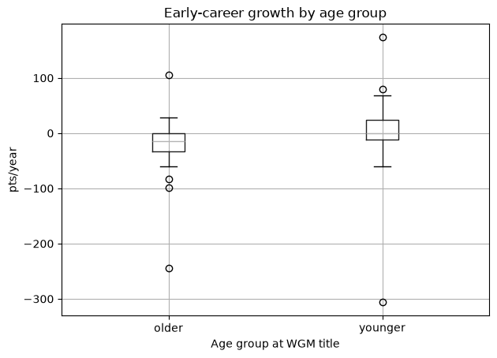
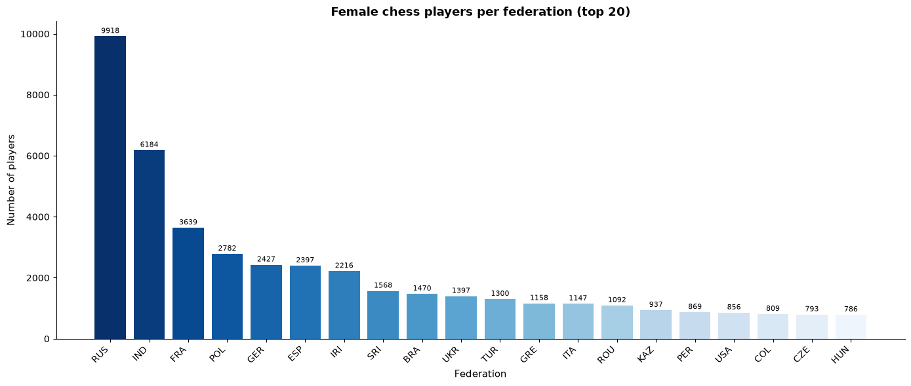
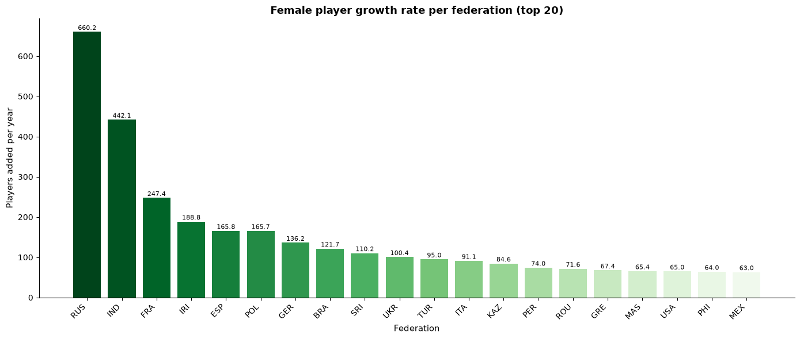
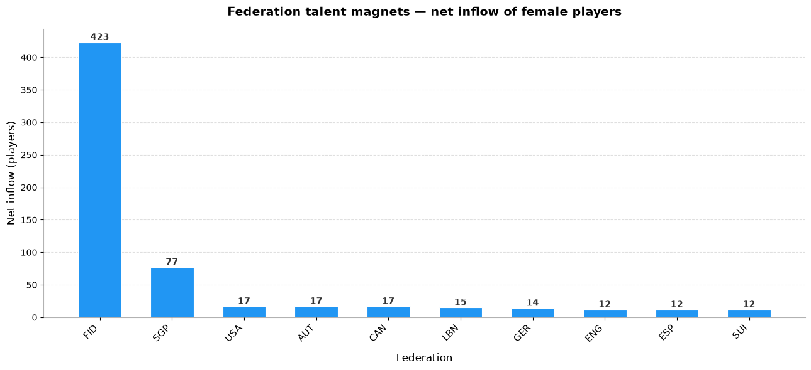
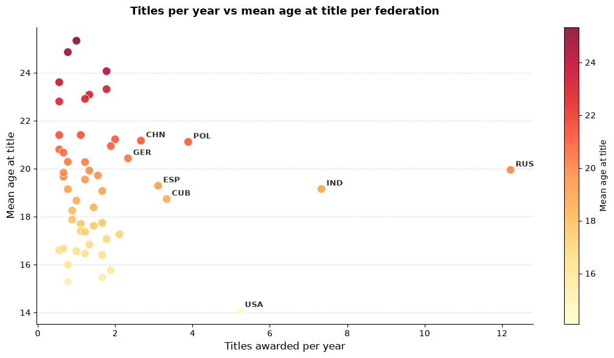

# ♕ Female Chess Players: Titles, Federations and Online Play

Exploratory data analysis and hypothesis testing on **~4.8 million monthly FIDE rating records (2015–2024)** covering **66,556 female chess players**, linked to **~300,000 chess.com games**.

**Tools:** Python · pandas · NumPy · SciPy · Matplotlib · Jupyter

📓 **[Open the full analysis notebook](notebooks/female_chess_analysis.ipynb)**

---

## Questions

1. **Titles and rating growth:** At what age do women earn their first master title, and do younger title holders improve faster?
2. **Federations:** Where are female players registered, which federations are growing fastest, and which attract players from other countries?
3. **Online play:** Does online activity on chess.com relate to age, federation or over-the-board rating?

## Key findings

| | Finding |
|---|---|
| 🎓 | **978** players earned a first master-level title during the period. The median age at title was **17** (range 9–66). |
| 📈 | **H1 supported:** players who became WGM younger than 22 gained **+2.4 pts/year** over the next 3 years. Older players lost **−19.6 pts/year** (one-sided t-test, *p* = 0.015). |
| 🌍 | **Russia (9,918)** and **India (6,184)** have the most female players. The top 5 federations hold **37.5%** of all female players. |
| 🚀 | Russia adds **~660** female players per year and India **~442**. Iran stands out for fast growth relative to its size. |
| 🧲 | **Singapore** is the clearest "talent magnet", with a net inflow of **+77** players. |
| ➖ | **H2 not supported:** federations that award more titles per year do not have younger recipients (*r* = −0.06, *p* = 0.68). |
| ♟️ | **9 of 12** players linked to chess.com score above their Elo expectation as White (382 games). |
| 💻 | **H3 not supported:** younger players play more online games on average (8,470 vs 4,561), but the difference is not significant (*p* = 0.22, n = 12). |

## Selected charts

| Rating trajectories: youngest vs oldest title holder | Early-career growth of WGMs by age group |
|---|---|
|  |  |

| Female players per federation | Federation growth 2015 → 2024 |
|---|---|
|  |  |

| Net inflow of players ("talent magnets") | Titles per year vs mean age at title |
|---|---|
|  |  |

## Approach

- **Event inference from panel data:** The data only records monthly snapshots, so title awards and federation transfers are detected as transitions between consecutive records of the same player. Players whose first record already shows a title are excluded, because their award date cannot be identified.
- **Correct unit of analysis:** The data is first reduced from player–month rows to one row per player (using the latest record) before counting players.
- **Growth metrics:** Rating growth is measured in points per year over a fixed 3-year window. Federation growth is the average number of players added per year between 2015 and 2024.
- **Joining data sources:** chess.com usernames are mapped to FIDE IDs. Each online game is matched with the player's most recent FIDE rating **strictly before** the game date, to avoid look-ahead bias.
- **Hypothesis testing:** One-sided two-sample *t*-tests and Pearson correlation with explicit H₀/H₁. Results are reported as associations, not causal effects.
- Every step is written as a short query plan (select → project → join → aggregate) before the code, and checked with `assert` statements.

## Limitations

- Only **12** female masters could be linked between chess.com and FIDE, so Part 3 results are indicative only.
- Title dates are inferred from monthly lists. The true award date may be earlier than the first month the title appears.
- The Elo comparison is from White's perspective and ignores first-move advantage. It also compares mostly bullet and blitz games against a classical FIDE rating.

## Repository structure

```
female-chess-analytics/
├── notebooks/
│   └── female_chess_analysis.ipynb   # full analysis with outputs
├── figures/                          # charts exported from the notebook
├── requirements.txt
└── README.md
```

## Reproducing

The raw data files are not included in this repository. To re-run the analysis, place the following files in a `data/` folder:

| File | Contents |
|---|---|
| `data/fide_ratings.csv.gz` | Monthly FIDE rating lists, Feb 2015 – Nov 2024 |
| `data/chesscom_games.csv.gz` | chess.com games |
| `data/chesscom_fide_mapping.csv` | chess.com username → FIDE ID |

```bash
pip install -r requirements.txt
jupyter notebook notebooks/female_chess_analysis.ipynb
```

The notebook reads the files from `../data/` relative to the `notebooks/` folder.

## Acknowledgements

Some data-loading and helper utilities (title-event detection, growth-rate calculation, account mapping) were adapted from provided starter code. The analysis, query design, statistical testing, visualisations and interpretation are my own.
